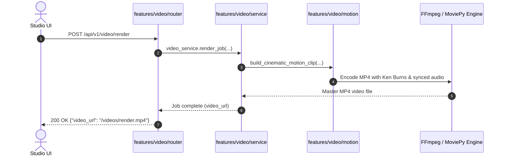

# Unified Video Feature Domain (`features/video`)

## 1. Overview
The **Video** domain is the high-performance media compilation and motion engine of Sonikoma. It transforms static storyboard panels into orchestrated, voice-acted cinematic animation videos with Ken Burns camera movements, 2.5D layer parallax, burn-in subtitles, and FFmpeg/MoviePy encoding.

---

## 2. Standardized Architecture

```
features/video/
├── __init__.py                               # Unified top-level package facade
├── schemas.py                                # All Pydantic request/response models & specs
├── service.py                                # VideoService class & singleton instance
├── README.md                                 # Architecture documentation & Mermaid diagrams
├── video_service_consolidation_plan.md       # Consolidated architecture specification
│
├── compiler/                                 # Multi-panel sequence compiler & audio sync
├── motion/                                   # Ken Burns 2D motions, camera shake, and 2.5D parallax
├── composition/                              # Canvas aspect ratio fitting, Gaussian blur fill, subtitle pills
├── operations/                               # Atomic FFmpeg operations (cutter, concat, filter, speed, audio)
├── export/                                   # Social platform export presets (YouTube, TikTok, WebP)
├── utils/                                    # Foundational resolutions, timecodes, and buffer resolvers
└── router/                                   # FastAPI modular router mounted on /api/v1/video
```

---

## 3. Usage Example

```python
from features.video import video_service, video_router
from features.video.schemas import RenderRequest

# In background worker or service:
await video_service.compile_video(
    panels=[...],
    aspect_ratio="16:9",
    subtitles_style="burn-in"
)
```

---

## 4. Mermaid Flow Diagram


